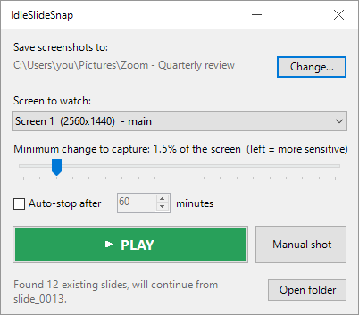
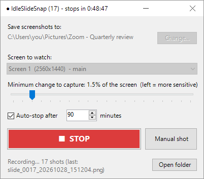
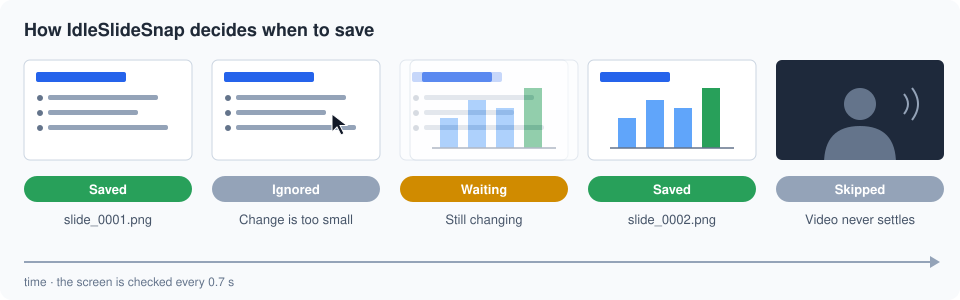
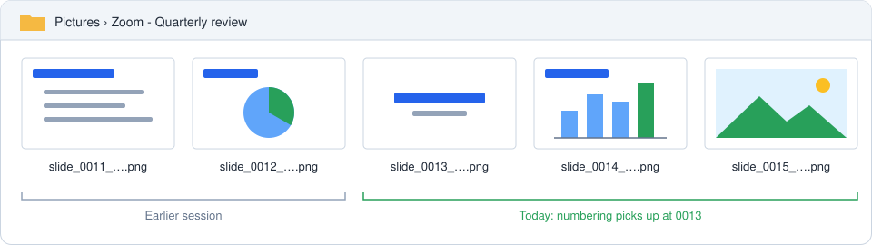

# IdleSlideSnap

A tiny Windows app (about 14 KB, no dependencies) that watches one of your monitors and quietly saves a screenshot whenever the screen changes in a meaningful way. It's made for grabbing every slide while you watch a presentation on Zoom, Teams and similar apps.

  
  &nbsp;
  

## 100% offline

IdleSlideSnap works completely offline. It never connects to the internet, has no telemetry, no accounts and no cloud. Your screenshots only go to the folder you choose on your own computer, and nothing else leaves your PC.

## Download

Grab `IdleSlideSnap.exe` from the [latest release](../../releases/latest) and run it. There's nothing to install.

## How to use it

1. Open `IdleSlideSnap.exe` and pick the folder where the screenshots should go.
2. Pick the screen to watch, if you have more than one monitor.
3. Hit **PLAY**. It keeps going until you hit **STOP**.
4. Optional: tick **Auto-stop after** and set the minutes, and it will stop by itself when the time is up. The title bar shows a countdown. You can change the minutes while it's recording.

Global hotkeys work even while another app is in front:

- **Ctrl+Alt+S**: play / stop
- **Ctrl+Alt+A**: take a screenshot manually

## How it works

- It looks at the screen every 0.7 seconds and compares it to the last saved screenshot, using a small grayscale thumbnail.
- It only saves when the image has changed **and** has stopped moving. This keeps it from catching a slide mid-transition or saving a playing video over and over.
- The sensitivity slider sets what percentage of the screen has to change before it counts as a new slide.
- The IdleSlideSnap window is hidden from its own screenshots.
- Screenshots are saved as PNG files named `slide_0001_YYYYMMDD_HHMMSS.png`.
- If the folder already has screenshots from an earlier session, numbering continues from the highest one instead of starting over.

## Building

Run `build.bat`. It uses the C# compiler that comes with Windows (.NET Framework 4), so there's nothing extra to install.
